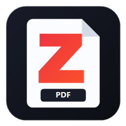

<div align="center">



# zPDF

**A fast, small, native PDF viewer and editor for Windows 10 & 11 (x64 and ARM64).**

</div>

---

## What it does

* **Opens PDFs quickly** and renders pages in tiles, only what's on screen, so zooming and scrolling stay responsive. A low-resolution preview appears instantly while sharp tiles fill in.
* **Edits text in place**: click a text run with the Edit tool (`T`), or click empty space to add new text. Edits use the run's existing font, so characters it doesn't contain may not render.
* **Fills forms**: click into AcroForm fields and type. While a field has focus, keys go to the field, never to tool shortcuts.
* **Highlights** selected text as real, removable PDF highlight annotations.
* **Stamps** vector checkmarks (`V`) and crosses (`X`).
* **Inserts images**: from a file, the clipboard (`Ctrl+V`), or by dropping an image onto the window. Position and resize with the 8-handle gizmo (corners keep the aspect ratio; hold `Shift` to stretch).
* **Redacts**: drag a box. Text objects and annotations touching it are deleted. Image pixels inside it are overwritten in the saved file, not just covered. Choose *Blackout* or *Erase* by right-clicking the Redact button. Limitation: whole text runs are removed (PDFium can't split them), and content nested inside Form XObjects isn't reached.
* **Manages pages**: rotate, insert blank pages, delete (with confirmation). Right-click a page or thumbnail.
* **Finds text**: `Ctrl+F` with live highlights; `Enter` / `Shift+Enter` / `F3` to step through. Long documents are searched in the background, nearest pages first.
* **Follows links and bookmarks**: click internal links to jump (`Alt+←` goes back); web links ask before opening in your browser. The sidebar's *Outline* tab lists the document's bookmarks and highlights the section you're in.
* **Selects text naturally**: drag in reading order, double-click a word, triple-click a line.
* **Opens password-protected PDFs** with an inline password prompt.
* **Prints**: `Ctrl+P` through the standard Windows print dialog.
* **Fits in**: follows the Windows light/dark setting and High Contrast, uses a dark title bar in dark mode, is per-monitor DPI aware, remembers your window position, lists recent files on the start screen, and reopens each recent file at the page and zoom you left it at.
* **Undo everything**: `Ctrl+Z` / `Ctrl+Y` across all edits. Undoing back to the last save clears the "unsaved" marker.
* **Saves safely**: documents are read into memory, and saving writes a temporary file and renames it over the original, so a crash mid-save can't corrupt the file.

## What it never does

* No subscriptions, ads, telemetry, analytics, or network calls.
* No nag screens. It offers once to become your default PDF app; "No thanks" is remembered.
* No external crates: `Cargo.toml` has zero dependencies. Rendering uses Google's [PDFium](https://pdfium.googlesource.com/pdfium/) (`pdfium.dll`, shipped alongside the exe).

---

## Shortcuts

| Key | Action |
| :--- | :--- |
| `Ctrl+O` / `Ctrl+S` / `Ctrl+Shift+S` | Open / Save / Save as |
| `Ctrl+P` | Print |
| `Ctrl+Z` / `Ctrl+Y` (or `Ctrl+Shift+Z`) | Undo / Redo |
| `Ctrl+F`, `F3` / `Shift+F3` | Find, next / previous match |
| `Ctrl+G` (or click the page box) | Go to page |
| `Alt+←` | Back to where you were before following a link |
| `Ctrl+C` / `Ctrl+V` | Copy selected text / paste an image |
| `H` `S` `T` `M` | Hand, Select text, Edit text, Highlight |
| `V` / `X` | Checkmark / cross stamp tool |
| `R` / `Shift+R`, `Del` | Rotate page clockwise / counter-clockwise, delete page |
| `Ctrl` + wheel, `Ctrl +` / `Ctrl −` | Zoom (anchored at the cursor when using the wheel) |
| `Ctrl+0` / `Ctrl+1` / `Ctrl+2` | Actual size / Fit width / Fit page (fit modes follow window resizes) |
| Arrows, `Space`, `PageUp`/`PageDown`, `Home`/`End` | Scroll (`Shift`+wheel scrolls sideways) |
| `F9` (or `Ctrl+B`) | Toggle page thumbnails |
| `Enter` / `Esc` | Commit / cancel the current text edit or image placement |

Hover any toolbar button for its name and shortcut.

---

## Installation

Download from [GitHub Releases](https://github.com/zaczzk/zPDF/releases). Each release lists SHA-256 checksums in `SHA256SUMS.txt`.

* **Installer (`zPDF-Setup-*.exe`)**: per-user install (no admin rights), Start-menu entry, uninstaller, and PDF file association. Installing a newer version upgrades in place.
* **Portable (`zPDF-*.zip`)**: extract and run. `pdfium.dll` must stay next to `zPDF.exe`; it is only ever loaded from that folder.

```powershell
.\zpdf.exe sample.pdf     # open a file
.\zpdf.exe --register     # register as a PDF handler for your account, then offer Default Apps settings
.\zpdf.exe --unregister   # remove zPDF's file-association registry entries (files are untouched)
.\zpdf.exe --self-test    # load pdfium.dll, create, render and save a test document
```

Windows decides the default PDF app itself. zPDF registers as a candidate and opens *Settings → Default apps*; it never edits the protected `UserChoice` keys.

### SmartScreen

Releases are not code-signed yet (a [SignPath Foundation](https://signpath.org) application is pending), so SmartScreen warns on first run. Verify the download against `SHA256SUMS.txt`, then use *More info → Run anyway*, or `Unblock-File .\zPDF.exe`.

---

## Building

```powershell
rustup target add x86_64-pc-windows-msvc      # or aarch64-pc-windows-msvc
cargo build --release --target x86_64-pc-windows-msvc
cargo test --release
```

`build.rs` compiles `resources.rc` (icon, version info, manifest) with `rc.exe` (MSVC) or `llvm-windres`/`windres` (GNU/LLVM-MinGW targets); the version comes from `Cargo.toml`. Put `pdfium.dll` in the repository root (or next to the test exe) to run the engine integration test in `tests/engine.rs`; without it the test is skipped. CI pins and verifies the PDFium download by SHA-256 (`.github/workflows/release.yml`).

### Layout

| Path | What |
| :--- | :--- |
| `src/pdfium.rs` | PDFium bindings: documents, pages, text, objects, annotations, forms |
| `src/editor.rs` | Text edits, stamps, images, highlights, redaction, undo history |
| `src/wic_decoder.rs` | Image decoding (Windows Imaging Component) and clipboard |
| `src/default_app.rs` | File-association registration |
| `src/gui/` | The Win32 interface: state, layout, tiled renderer, painting, input, commands |

---

## License

See [LICENSE](LICENSE).
